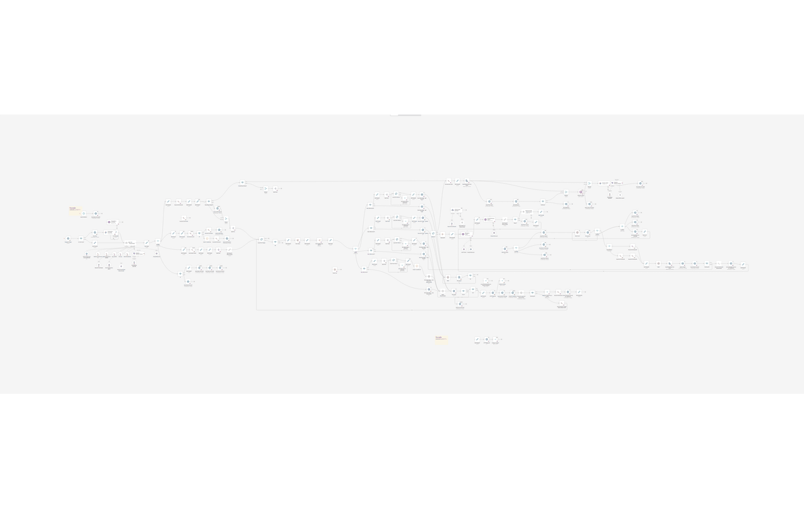
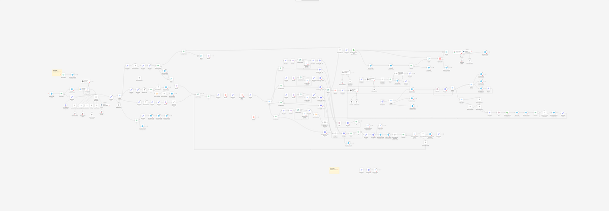

# AI video generation pipeline in n8n (structure showcase)

My largest n8n workflow (185 nodes): from an idea sent on Telegram (text or voice) to a finished short video, with AI agents writing the plan and the prompts, several image and video generation APIs, ffmpeg for editing, and me approving each step from Telegram. This repo shows the **structure only**: every node, its type and every connection, with all parameters and prompts removed on purpose.

> The GIF shows the structure-only export imported into a local n8n instance. Nothing runs here: the export has no parameters, prompts or credentials. In that n8n 2.4.7 test instance the Execute Command nodes appear as unknown ("?") nodes.

**Full diagram (vector, zoom in as far as you like):** [docs/video-pipeline.svg](docs/video-pipeline.svg)

## Why only the structure

The prompts and the way the agents work together are the part I spent the most time on, so I keep them private. The structure is enough to show the architecture, and I can explain any node in detail. The workflow was a prototype: it is unfinished, and I later started rebuilding the same idea as a Node.js application.

## What the pipeline does (from the node graph)

1. **Input on Telegram.** A Telegram trigger receives an idea; voice messages are transcribed (OpenAI and Gemini transcription nodes). A scheduled trigger can also send an invitation to start.
2. **Main agent with tools.** An AI agent with memory decides what to do next. Its tools include: listing and cleaning up earlier runs (shell commands), a PGVector store with OpenAI embeddings (knowledge from earlier videos), and a separate "Creative Sub-Agent" workflow.
3. **Director brief and images.** A director brief is produced, then images are generated per scene through HTTP calls to several image models (gpt-image, GPT-4o image, Gemini "nano banana"), optionally with reference images loaded from Google Cloud Storage. Each image is sent to Telegram for my approval or feedback before it is stored.
4. **Video prompts with review.** A "Video Prompt generator" agent writes the prompts for each scene, a "Prompt Reviewer" checks them (with a think/self-check tool), and failed checks loop back.
5. **Scene generation.** Scenes are generated through a video generation API, with waits and polling, and with separate messages for provider errors or when credits must be topped up.
6. **Editing and delivery.** ffmpeg (Execute Command) concatenates the clips and handles aspect ratios; the final video is sent on Telegram, where I can approve, ask for changes or stop.
7. **Learning loop.** A finished video can be uploaded to YouTube, analysed by Gemini, and the analysis stored in the PGVector store for later runs.

## Architecture

Colours: AI agents and models, Telegram (human in the loop), HTTP calls to external generation APIs, shell/ffmpeg, storage, sub-workflows and flow control. Dashed lines are AI connections (model, memory, tools); faded boxes are disabled nodes.

## Tech stack

n8n (AI Agent, Telegram trigger and send-and-wait, HTTP Request, Execute Command, Google Cloud Storage, Postgres PGVector store, OpenAI embeddings, Data Table, YouTube, sub-workflows), OpenAI API, Google Gemini API, image and video generation APIs, ffmpeg, PostgreSQL with pgvector, Telegram Bot API.

## How to use this repo

Import `workflow/video-pipeline.skeleton.json` into n8n to explore the graph (Workflows > Import from file). It will not run: every node is empty by design.

## My contribution

Solo project: I designed and built the workflow.

## Status and limitations

- Prototype, unfinished. I stopped extending it in n8n and started a Node.js version of the same idea.
- With 185 nodes in one workflow, the canvas is hard to maintain: duplicated branches for each image model, many "Edit Fields" steps, and logic spread across nodes.

## What I would change for production

- Move the orchestration to code (one job queue, typed steps, retries and idempotency per scene) and keep n8n, if at all, for integrations.
- One image/video provider interface instead of a branch per model.
- Cost tracking per video and limits per run.
- Store every intermediate result (brief, prompts, images, clips) with versions so a run can resume after a failure.
